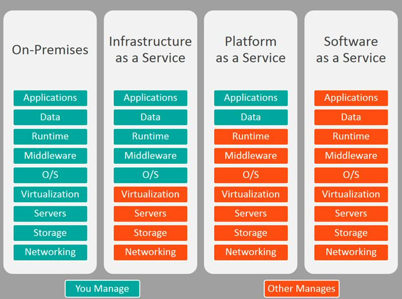

# Conceitos de cloud

Antes tinha os server room (DC, datacenter). Dentro dessas salas tinham vários servidores

Ai tínhamos a network que conectava esses servidores

Era caro manter todos esses servidores (eles esquentam, precisam ser bem protegidos, demora pra montar…)

> 📌 Os nossos serviços não rodam mais em servidores locais da empresa, e sim é utilizado recursos de empresas como a AWS para hospedar seus serviços remotamente. Dessa forma, em empresas não precisavam mais possuir servidores físicos para conseguir ter seus serviços rodando.

## Benefícios

- velocidade para implementar e desenvolver novas soluções
- reduz custo
    - assinar contratos com a AWS (de anos fechados) pode gerar descontos na assinatura
- atualizações (de sistema operacional, atualizações no sistema etc) são feitas pela AWS sem interromper o serviço que está rodando
- data security
    - maioria dos serviços com backup automático
    - segurança dos dados
- escalabilidade
    - facilidade em aumentar e reduzir os recursos para nossos serviços
    - aumentar CPU, aumentar RAM (ou diminuir)
    - possibilidade de configurar escalabilidade automática

## Tipos de cloud

### IaaS

Infra as a Service

A infraestrutura como serviço (IaaS) é um modelo de computação em nuvem em que um provedor terceirizado hospeda recursos de computação virtualizados, como servidores, armazenamento e rede, pela internet. Os clientes podem acessar e usar esses recursos em uma base de pagamento por uso, sem precisar investir e manter sua própria infraestrutura física.

Exemplo:

- AWS EC2

### PaaS

Platform as a Service

A Plataforma como Serviço (PaaS) é um modelo de computação em nuvem em que um provedor terceirizado entrega ferramentas de hardware e software, geralmente necessárias para o desenvolvimento de aplicativos, aos usuários pela internet.

Exemplos:

- AWS é o beanstalk
- No Google é o App Engine

As funções Lambda da AWS podem parecer Paas porém são FaaS (Function as a service)

### SaaS

Software as a Service

Software como Serviço (SaaS) é um modelo no qual o software é fornecido aos usuários pela internet, em vez de ser instalado em seus dispositivos locais. Os usuários geralmente pagam uma taxa de assinatura para acessar o software e suas atualizações.

Exemplos:

- Google Docs
- Office 365
- Gmail
- Aftersale troque fácil

## Redes

### Public cloud

Oferecida por provedores Cloud como AWS, Google Cloud e Azure.

Da acesso aos seus serviços a qualquer pessoa que esteja na internet, podendo usar o serviço desses provedores.

Mas o seu servidor e seu serviço rodando dentro desses provedores É SEU (ninguém mais tem acesso)

Custo mais baixo

> ***A AWS seus serviços de Cloud ao público (as provedoras de cloud oferecem ao público)***

### Hybrid cloud

Mistura os dois. 

Você pode ter alguns dos seus serviços hospedados em um public, e outro num private.

Exemplo: a landing page da sua aplicação fica num serviço public cloud

Porém seu servidor e seu banco de dados com dados do cliente você hospeda em uma private cloud por exemplo

### Private cloud

Oferecido pelos provedores também. AWS, GCP e Azure também oferecem

Mas aqui é alugado os servidores FÍSICOS em si

Você não compartilha os recursos físicos com mais ninguém, você aluga da AWS e então é só seu

Custo mais alto

## Shared Responsability Model

Algumas coisas são nossas responsabilidades, e outras são responsabilidades da Amazon

A AWS é responsável da NUVEM

- Se preocupa com a segurança dos servidores físicos
- Com energia
- Com autorização para quem tem acesso aos recursos físicos

O cliente é responsável é responsável pela segurança NA NUVEM

- Nós temos a responsabilidade pela segurança da nossa aplicação
- Devemos cuidar quem pode acessar/enviar requisições a nossa aplicação
- Devemos controlar quem tem acesso aos dados que nós salvamos em storage na AWS
- Devemos tomar conta da parte de hashes e senhas para acesso a nossa aplicação
- LGDP é nossa responsabilidade